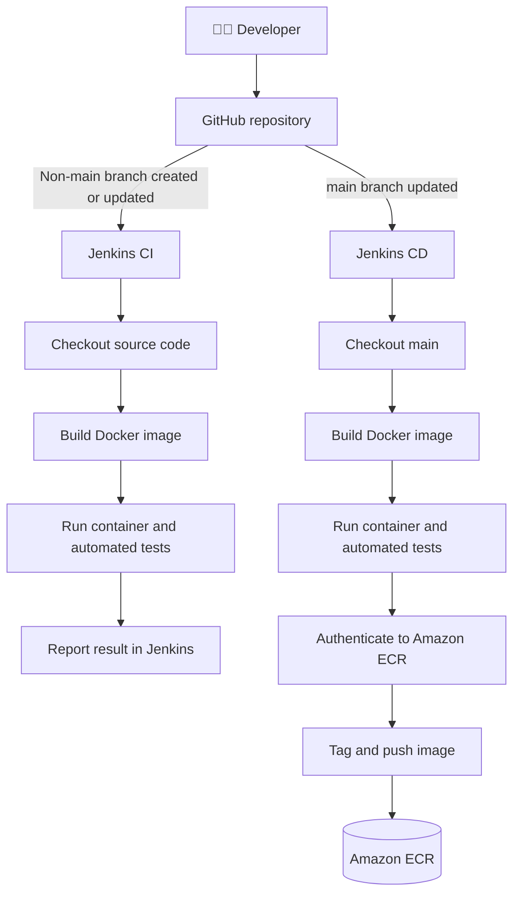

# 🚀 CI/CD Project — GitHub, Docker, Jenkins & Amazon ECR

[](https://www.jenkins.io/)
[](https://www.docker.com/)
[](https://aws.amazon.com/ecr/)
[](https://github.com/)
[](https://www.python.org/)

A hands-on DevOps portfolio project that demonstrates **branch-based CI, automated Docker builds and tests, and Continuous Delivery of container images to Amazon Elastic Container Registry (ECR)** using GitHub and Jenkins.

> 🎯 **Goal:** Validate changes on non-`main` branches and publish a tested, versioned Docker image from `main` to Amazon ECR, ready for a later deployment.

---

## 📚 Table of Contents

- [✨ Project Overview](#-project-overview)
- [🏗️ Architecture](#️-architecture)
- [🔄 Pipeline Workflows](#-pipeline-workflows)
- [🧰 Technology Stack](#-technology-stack)
- [📁 Repository Structure](#-repository-structure)
- [⚙️ Prerequisites](#️-prerequisites)
- [🎓 What This Project Demonstrates](#-what-this-project-demonstrates)
- [🚧 Future Improvements](#-future-improvements)

## ✨ Project Overview

This project uses a simple Python Flask application to demonstrate a practical CI/CD workflow.

### Objective 1 — Continuous Integration (CI)

Trigger a Jenkins pipeline whenever a **non-`main` branch is created or updated**.

The CI pipeline is designed to:

1. Check out source code from the branch.
2. Build a Docker image using the repository's `Dockerfile`.
3. Create and start a container from the image.
4. Execute the configured automated tests.
5. Report the build and test results in Jenkins.

**Purpose:** validate code changes early and detect failures before they are merged into `main`.

### Objective 2 — Continuous Delivery (CD)

Trigger a Jenkins pipeline whenever the **`main` branch is updated**.

The CD pipeline is designed to:

1. Check out source code from `main`.
2. Build a Docker image.
3. Create and start a container to run automated tests.
4. Authenticate to Amazon ECR.
5. Tag and push the image to ECR.

**Purpose:** publish a tested, versioned Docker image that is ready for a subsequent deployment.

> ℹ️ Publishing an image to ECR is Continuous Delivery; it does not by itself deploy the application to a running server.

## 🏗️ Architecture

### High-level architecture



### 🔁 Branch-to-pipeline strategy

| GitHub event | Jenkins pipeline | Expected result |
|---|---|---|
| Non-`main` branch created or updated | CI | Build image, run tests, report result |
| `main` branch updated | CD | Build image, run tests, push image to ECR |

Branch discovery and automatic triggering depend on the Jenkins Multibranch Pipeline configuration and the GitHub webhook or polling configuration. The Jenkinsfile path and branch conditions must match the repository setup.

### 🧩 Component responsibilities

| Component | Responsibility |
|---|---|
| GitHub | Version control and branch-based collaboration |
| Jenkins | Pipeline orchestration, automation and build reporting |
| Docker | Packages application code and dependencies into a container image |
| Flask | Provides the example web application |
| pytest | Runs automated application tests |
| Amazon ECR | Stores versioned container images |

## 🔄 Pipeline Workflows

### 🧪 CI — `jenkins/Jenkinsfile.ci`

The CI pipeline validates code changes on non-`main` branches.

1. **Branch validation** — apply the non-`main` branch policy.
2. **Checkout** — retrieve source code from GitHub.
3. **Build** — create an image tagged with the Jenkins build number.
4. **Test** — start a container and execute the command configured in the Dockerfile.
5. **Report** — mark the build as successful or failed in Jenkins.

### 📦 CD — `jenkins/Jenkinsfile.cd`

The CD pipeline validates the `main` branch and publishes the image.

1. **Checkout** — retrieve the latest code from `main`.
2. **Build** — build the Docker image.
3. **Test** — run the automated test suite inside a container.
4. **Authenticate** — log Docker in to the ECR registry using AWS credentials.
5. **Tag** — tag the image with the ECR registry, repository and build version.
6. **Push** — upload the image to Amazon ECR.

A failed build or test should stop the pipeline before the image is pushed.

## 🧰 Technology Stack

- 🐙 **GitHub** — source control
- 🔧 **Jenkins** — CI/CD automation
- 🐳 **Docker** — image build and container runtime
- 🐍 **Python 3.11** — application runtime
- 🌶️ **Flask** — web application framework
- 🧪 **pytest** — automated testing
- ☁️ **Amazon ECR** — Docker image registry
- 🖥️ **Jenkins agent / build host** — executes pipeline steps

## 📁 Repository Structure

```text
.
├── app/
│   └── app.py                  # Flask application and root endpoint
├── tests/
│   └── test_app.py             # Automated test for GET /
├── jenkins/
│   ├── Jenkinsfile.ci          # Continuous Integration pipeline
│   └── Jenkinsfile.cd          # Continuous Delivery pipeline
├── deploy/                     # Deployment-related files, if configured
├── Dockerfile                  # Docker image instructions and default command
├── requirements.txt            # Python dependencies
└── README.md                   # Project documentation
```

> 📌 Update this tree if your repository has additional files, such as `ansible/`, or if filenames and locations change.

## ⚙️ Prerequisites

For the local workflow:

- Git
- Python 3.11
- Docker Engine or Docker Desktop

For Jenkins CI/CD:

- Jenkins with a Multibranch Pipeline job
- A Jenkins agent with Docker CLI and access to a Docker daemon
- GitHub repository access and a webhook or polling configuration
- AWS CLI on the agent for ECR authentication
- AWS credentials or an IAM role with the necessary ECR permissions
- An existing ECR repository in the selected AWS Region


## 🎓 What This Project Demonstrates

- Branch-based CI/CD design
- Jenkins Declarative and Multibranch Pipeline concepts
- Docker image builds, tags and container execution
- Automated testing with pytest
- AWS CLI authentication to Amazon ECR
- Publishing versioned Docker images
- Jenkins credential and IAM permission awareness

## 🚧 Future Improvements

Enhancements for the next iteration:

- 🤖 Add Ansible to deploy the ECR image to an EC2 instance.

---
